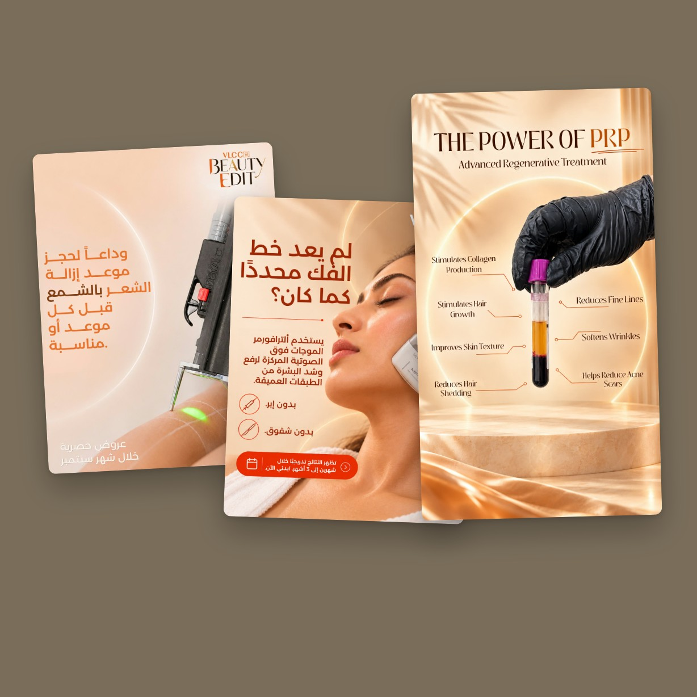
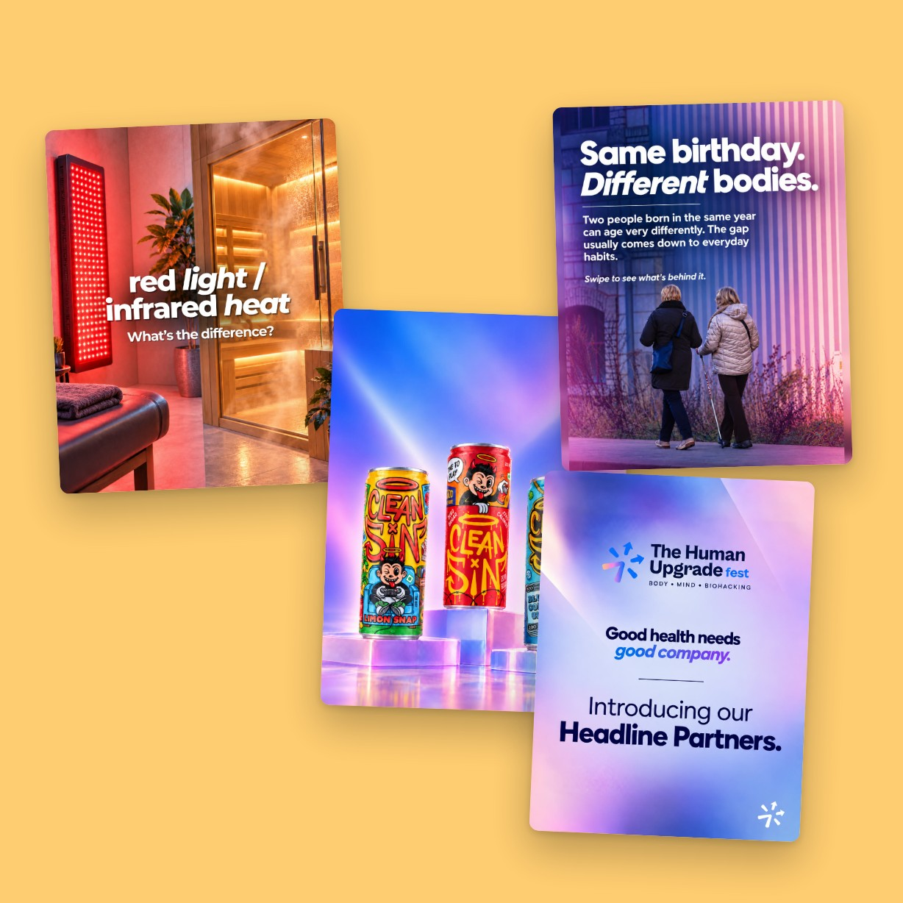
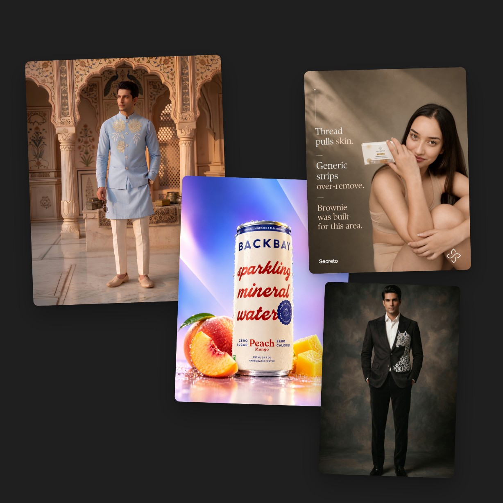
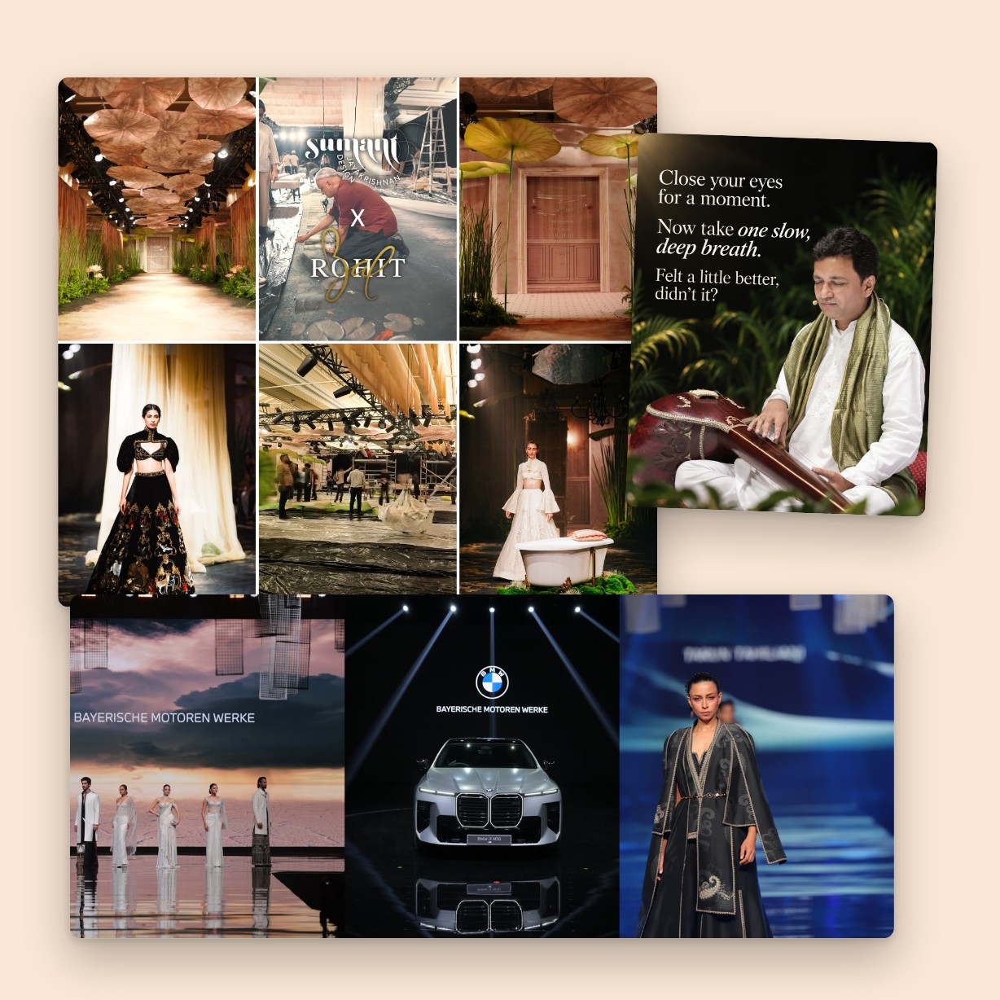
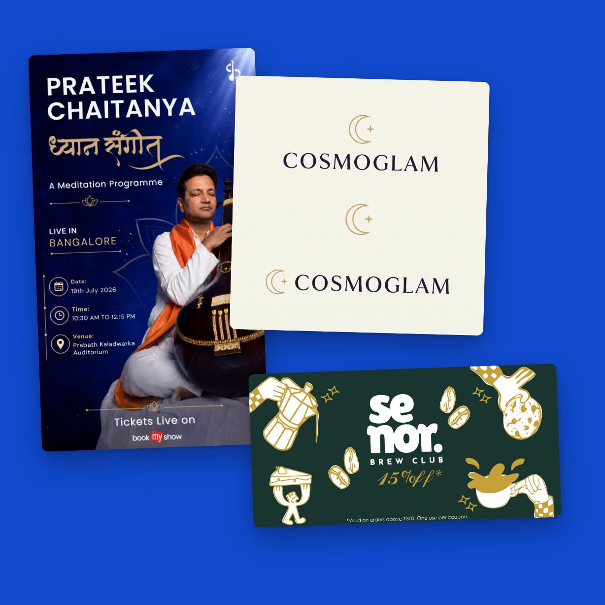

# Creative work

Selected social, campaign, video and design work by **Karan Kamboj**, creative technologist. This is the non-code half of my portfolio; the code half is in my other repositories.

**Portfolio site:** https://portfolio-rebuild-eta.vercel.app/ · **Email:** karan.kamboj1612@gmail.com

I direct the look of each brand, then produce it end to end. Much of the imagery is AI-assisted: I art-direct the tools and finish the result to each brand's own style.

## Aesthetic clinic campaigns
Arabic-first social creatives for an aesthetic clinic in the Gulf: offer posts, treatment stories and carousels, designed right to left around real treatment and device photography. Includes a seasonal beauty campaign and its English-to-Arabic adaptations.

## Wellness festival launch
Launch content for a wellness and biohacking festival: announcement posts, stories, headline-partner slides and branded creatives for dozens of sponsors, exhibitors and speakers. I also edited the event film and added subtitles to speaker videos.

## Fashion and product visuals
Collection imagery and reels for a menswear label, product shots for beverage and beauty brands, and carousels that explain a product in a few slides. AI-assisted, art-directed and finished to each brand's look.

## Instagram grids and events
Grids planned to read as one story: runway set-design coverage for a fashion show, a luxury car reveal at a designer showcase, a concert campaign for a musician, and the Senor Brew Club account. Covers, sequencing, colour and reels, kept consistent.

## Posters, logos and print
Event posters, logo concepts for a wellness clinic, and print pieces such as a café coupon. Clear hierarchy and clean typography, built around each brand.

## Related code projects
- [Senor Brew Club POS](https://github.com/justkarank/senor-brew-pos): full-stack café POS
- [Puhoor: Toda Embroidery](https://github.com/justkarank/puhoor-toda-embroidery): interactive scroll exhibition

## Notes
Client brand names and logos that appear inside the creatives belong to their owners. © Karan Kamboj. All rights reserved.
